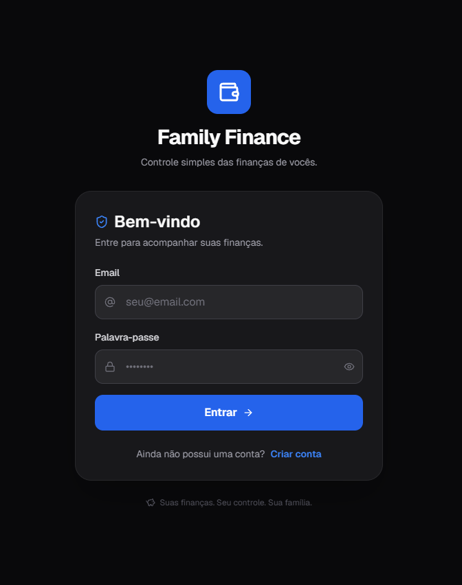
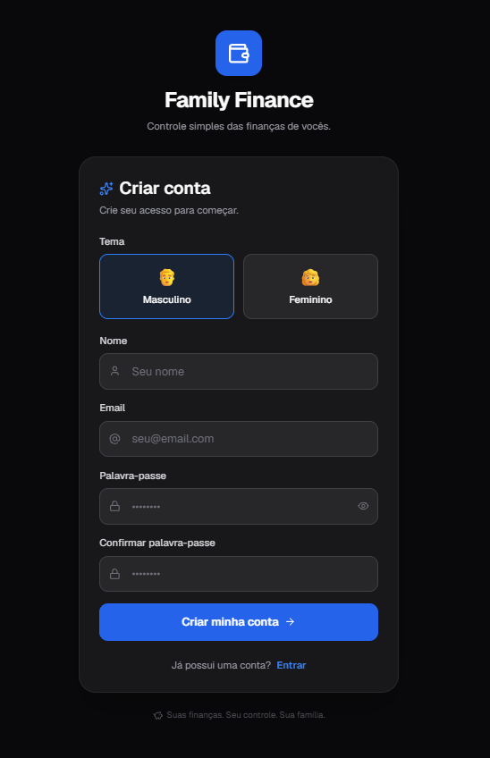
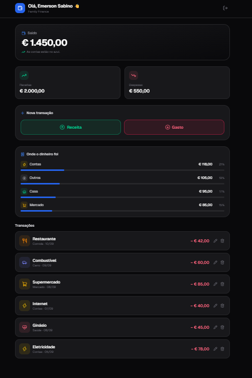

# Family Finance

Controle simples das finanças da família. Next.js 16 (App Router) +
Tailwind v4 + lucide-react, com Supabase à frente e Prisma no servidor.

O detalhe de cada função está em
[docs/funcoes-do-sistema.md](docs/funcoes-do-sistema.md).

## Telas

| Login | Cadastro | Dashboard |
|:---:|:---:|:---:|
|  |  |  |

## Estrutura

```
src/
├── app/
│   ├── login/          entrar
│   ├── register/       criar conta (escolhe o tema: azul ou rosa)
│   ├── dashboard/      saldo, receitas, despesas, últimos gastos
│   ├── expenses/       lista de gastos — editar e excluir
│   ├── income/         lista de receitas
│   ├── wishes/         desejos: o que falta comprar e quanto já está guardado
│   ├── admin/          painel admin: contas, acessos e dispositivos
│   ├── api/
│   │   ├── track/      regista cada acesso (aparelho, sistema, local)
│   │   └── admin/      users, accesses e me — só para quem é admin
│   ├── layout.tsx      raiz, envolve tudo no StoreProvider
│   ├── globals.css     tema (variáveis --accent)
│   └── page.tsx        redireciona para /login ou /dashboard
│
├── components/
│   ├── Header.tsx            saudação + sair
│   ├── Card.tsx              cartão de valor (saldo em destaque ou resumo)
│   ├── ExpenseItem.tsx       linha da lista, com ícone da categoria
│   ├── BottomNav.tsx         navegação inferior
│   ├── AppShell.tsx          guarda de sessão + Header + BottomNav
│   ├── AuthCard.tsx          moldura de login/registo
│   ├── TransactionModal.tsx  formulário de novo/editar lançamento
│   ├── TransactionsView.tsx  lista usada por expenses e income
│   ├── WishItem.tsx          um desejo, com a barra do que já está guardado
│   └── WishModal.tsx         formulário de novo/editar desejo
│
└── lib/
    ├── supabase.ts     cliente (ainda sem credenciais)
    ├── prisma.ts       cliente do servidor (painel admin e acessos)
    ├── server-auth.ts  valida a sessão e a permissão nas rotas /api
    ├── api.ts          fetch para /api já com o token
    ├── store.tsx       estado + persistência
    ├── categories.ts   categorias, ícones e cores
    ├── wishes.ts       prioridades, ordem e totais dos desejos
    ├── user-agent.ts   tipo de aparelho, sistema e navegador
    ├── geo.ts          país, estado e cidade do acesso
    ├── admin.ts        o que o painel troca com a API
    ├── format.ts       euro e datas
    └── types.ts
```

O alias `@/` aponta para `src/`.

## Rodar

```bash
npm run dev
```

## Dados

O app tem dois backends e escolhe sozinho, conforme o `.env.local`:

| | sem `.env.local` | com `.env.local` |
|---|---|---|
| dados | `localStorage`, com exemplos | tabela `public.transactions` |
| login | falso (qualquer email entra) | Supabase Auth, com confirmação por email |

As telas não sabem a diferença — falam só com `useStore()` ([lib/store.tsx](src/lib/store.tsx)).

### Ligar ao Supabase

1. No painel: **SQL Editor** → correr [supabase/schema.sql](supabase/schema.sql)
   (cria as tabelas e as policies de RLS — cada pessoa só vê a sua carteira).
   Num projeto que já tinha dados, correr antes
   [supabase/002_carteira_partilhada.sql](supabase/002_carteira_partilhada.sql)
   e depois [supabase/003_desejos_e_acessos.sql](supabase/003_desejos_e_acessos.sql).
2. Copiar `.env.example` para `.env.local` e preencher com os valores de
   **Project Settings → API**:

   ```
   NEXT_PUBLIC_SUPABASE_URL=...
   NEXT_PUBLIC_SUPABASE_ANON_KEY=...
   ```
3. Reiniciar o `npm run dev`.

Depois disso é preciso **criar uma conta nova** em `/register` e confirmar o
email — as contas antigas viviam só no navegador. Os lançamentos de exemplo
também não são migrados: a tabela começa vazia.

### Carteira partilhada

As policies dão acesso **por carteira**, não por pessoa: quem partilha a
carteira vê, edita e exclui os mesmos lançamentos. `user_id` fica só como
registo de quem lançou, e aparece na lista quando há mais de uma pessoa.

Para juntar duas contas:

1. cada pessoa cria a sua conta em `/register`;
2. uma delas copia o **código do convite** no cartão "Carteira partilhada"
   do dashboard;
3. a outra cola esse código e clica em Entrar — os lançamentos que já tinha
   vão com ela para a carteira partilhada.

### Categorias

A coluna `category` é texto livre. O app guarda ids próprios
(`mercado`, `carro`, `comida`, `contas`, `saude`…), cada um com ícone e cor
em [lib/categories.ts](src/lib/categories.ts).

## Desejos

`/wishes` é a lista do que a família quer comprar: preço, quanto já está
guardado, prioridade e uma data alvo. A barra mostra o que falta juntar, e
o botão **Comprado** passa o desejo para os realizados.

Vive na tabela `public.wishes`, com as mesmas regras de carteira dos
lançamentos — quem partilha a carteira vê e edita a mesma lista.

## Painel admin

`/admin` mostra quem tem conta, quais estão ativas, quem entrou nas
últimas 24 horas e, por pessoa, o último login com data e hora, o
aparelho, o sistema operativo, o navegador e o local do acesso (país,
estado e cidade). Ao abrir uma linha aparece o histórico completo de
acessos dessa pessoa.

O atalho para o painel só aparece a quem é admin. Para marcar o primeiro,
pôr o email em `ADMIN_EMAILS` (no `.env`) ou correr:

```sql
update public.profiles set is_admin = true
where id = (select id from auth.users where email = 'eu@exemplo.com');
```

### Prisma

O painel e o registo de acessos leem `auth.users`, onde o cliente do
navegador não chega — daí o Prisma, do lado do servidor.

1. Em **Project Settings → Database**, copiar as duas connection strings
   para o `.env` (é esse que o Prisma CLI lê):

   ```
   DATABASE_URL=...   # com pool, porta 6543
   DIRECT_URL=...     # direta, porta 5432
   ```
2. `npm run db:generate` (o `npm install` já o faz).

Não se corre `prisma migrate`: o esquema nasce dos ficheiros em
`supabase/`. Depois de mudar o SQL, `npm run db:pull` põe o
`schema.prisma` a par.

Sem `DATABASE_URL` o app funciona na mesma — sem painel admin e sem
registo de acessos.
